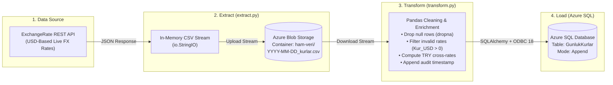

<div align="center">

# 💸 Azure Cloud FX Rates ETL Pipeline

### *Automated Exchange Rate Ingestion, In-Memory Transformation & Azure SQL Data Warehouse Loading*

[](https://www.python.org/)
[](https://pandas.pydata.org/)
[](https://azure.microsoft.com/)
[](https://azure.microsoft.com/)
[](https://azure.microsoft.com/)
[](https://www.sqlalchemy.org/)

</div>

---

## 📌 Overview

This project is an end-to-end **Cloud ETL (Extract, Transform, Load)** data pipeline that pulls daily global foreign exchange (FX) rates from a **REST API**, archives raw daily snapshots in **Azure Blob Storage (Data Lake)**, cleans and enriches the dataset in memory with **Pandas**, and appends analytics-ready records into **Azure SQL Database**.

All file serialization and deserialization steps operate **in memory via `io.StringIO`**, eliminating unnecessary local disk I/O and keeping the pipeline lightweight and cloud-ready.

---

## 🏗️ Pipeline Architecture



---

## ⚡ Pipeline Stages

### 1. Extract (`extract.py`)
- Fetches live USD-based currency exchange rates in JSON format from `ExchangeRate-API`.
- Converts the payload into a Pandas DataFrame stamped with the extraction date (`YYYY-MM-DD`).
- Serializes to CSV purely in memory (`io.StringIO`) and uploads daily raw snapshots (`YYYY-MM-DD_kurlar.csv`) to the `ham-veri` container in **Azure Blob Storage**.

### 2. Transform (`transform.py`)
- Streams the daily raw CSV directly from **Azure Blob Storage** into Pandas.
- **Data Cleaning:** Drops missing values (`dropna()`) and filters out non-positive/corrupted rates (`Kur_USD > 0`).
- **Feature Engineering:** Computes the live **Turkish Lira (TRY) cross-rate** (`TRY_Karsiligi`) for every currency relative to USD/TRY.
- **Auditability:** Stamps each batch with an exact ingestion timestamp (`Yukleme_zamani`).

### 3. Load (`transform.py`)
- Establishes a TLS-encrypted connection (`Encrypt=yes;TrustServerCertificate=no;`) to **Azure SQL Database** via SQLAlchemy and `ODBC Driver 18 for SQL Server`.
- Appends cleaned daily records (`if_exists="append"`) to the `GunlukKurlar` table to build a historical time-series dataset.

---

## 📊 Target Table Schema (`GunlukKurlar`)

| Column | Type | Description |
| :--- | :--- | :--- |
| `Para_Birimi` | `VARCHAR` | ISO currency code (e.g., `EUR`, `GBP`, `TRY`, `JPY`) |
| `Kur_USD` | `FLOAT` | Currency rate relative to 1 USD |
| `Tarih` | `DATE` | Snapshot extraction date (`YYYY-MM-DD`) |
| `TRY_Karsiligi` | `FLOAT` | Calculated Turkish Lira value of 1 unit of currency |
| `Yukleme_zamani` | `DATETIME` | Pipeline load audit timestamp |

---

## 📂 Repository Structure

```text
azure-fx-rates-etl-pipeline/
├── .env.example          # Environment variable template (no secrets)
├── .gitignore            # Excludes .env, .venv, __pycache__
├── requirements.txt      # Python dependencies
├── extract.py            # REST API -> Azure Blob Storage ingestion
├── transform.py          # Azure Blob -> Pandas transformation -> Azure SQL load
└── README.md             # Project documentation
```

---

## 🚀 Quick Start

### 1. Prerequisites
- Python 3.10+
- [Microsoft ODBC Driver 18 for SQL Server](https://learn.microsoft.com/en-us/sql/connect/odbc/download-odbc-driver-for-sql-server)
- Microsoft Azure **Blob Storage** container (`ham-veri`) & **Azure SQL Database**

### 2. Clone & Install Dependencies
```bash
git clone https://github.com/blgnr1/azure-fx-rates-etl-pipeline.git
cd azure-fx-rates-etl-pipeline

python -m venv .venv
# Windows:
.venv\Scripts\activate
# Linux / macOS:
source .venv/bin/activate

pip install -r requirements.txt
```

### 3. Configure Environment Variables
Copy `.env.example` to `.env` and fill in your Azure credentials:
```bash
cp .env.example .env
```

```ini
AZURE_STORAGE_CONNECTION_STRING="DefaultEndpointsProtocol=https;AccountName=<your_account>;AccountKey=<your_key>;EndpointSuffix=core.windows.net"
DB_SERVER="<your-sql-server>.database.windows.net"
DB_DATABASE="<your_database>"
DB_USERNAME="<your_sql_username>"
DB_PASSWORD="<your_secure_password>"
```

### 4. Run the Pipeline
```bash
# Step 1: Extract live FX rates into Azure Blob Storage
python extract.py

# Step 2: Clean, enrich, and load into Azure SQL Database
python transform.py
```

---

## 🔒 Security

- All connection strings and database credentials are read exclusively from environment variables via `python-dotenv`.
- `.env` and local environments are excluded via `.gitignore`.
- Azure SQL traffic enforces encrypted TLS transport (`Encrypt=yes;TrustServerCertificate=no;`).

---

<div align="center">
  <sub>Built by <b>Kerem Bilginer</b> · <a href="https://www.linkedin.com/in/kerem-bilginer/">LinkedIn</a> · <a href="https://www.blgnr1.com/">Portfolio</a></sub>
</div>
